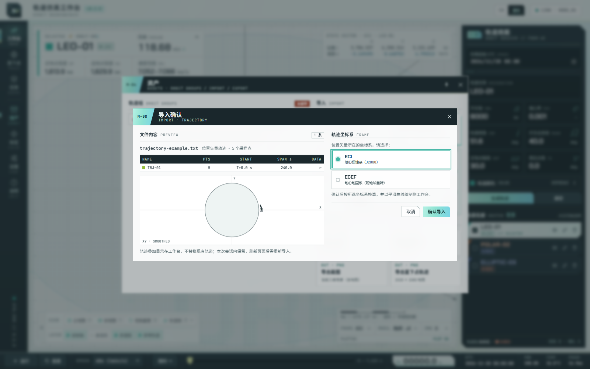
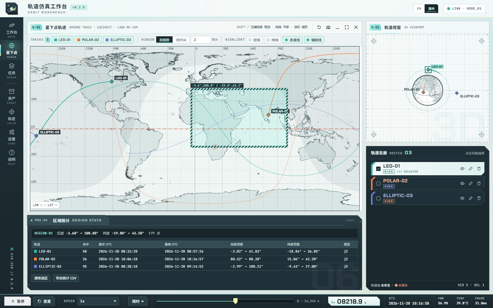
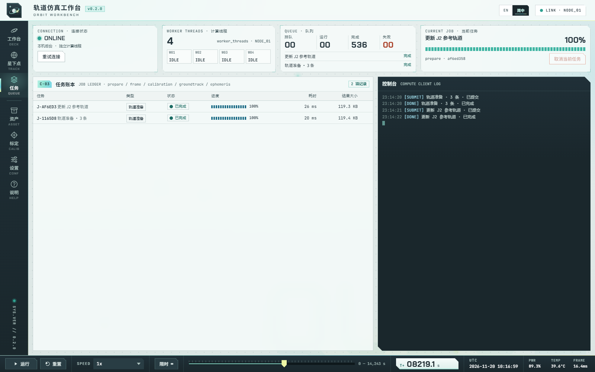

# 轨道仿真工作台 · Orbit Workbench

**v0.2.0** 对应 Trajectory Demonstration v2.0。这是一个在本机运行的轨道演示工具。输入轨道六根数，即可在 ECI（地心惯性）或 ECEF（地心地固）坐标系中观察航天器运行，把同一组轨道投影到世界地图，并查看它们经过选定区域的时间。轨道计算由本机 Node.js 工作线程执行，界面支持简体中文和英文。

[安装与启动](#安装与启动) · [界面演示](#界面演示) · [从旧版迁移](#从旧版迁移) · [操作手册](docs/user-guide.md)

## 界面演示

以下截图取自 v0.2.0 实际运行的工作台，使用内置演示轨道和「说明」中可下载的轨迹示例。在工作台中央点击 **载入演示轨道** 即可开始体验。

### 工作台

选中名册中的 **LEO-01** 后，左上角显示周期、近地点和远地点高度，右侧「轨道档案」显示它的六根数。按 P 打开「轨道面」，点击「取选中轨道」即可沿轨道面法向观察。底栏控制播放与仿真时间。


### 导入位置矢量轨迹

在 **资产 → 导入轨道 / 轨迹数据 → 导入轨迹** 中选择 TXT 文件。确认窗口会列出每条轨迹的采样点数、起始时刻和覆盖时长，并显示平滑曲线预览。选择文件使用的 ECI 或 ECEF 坐标系后，轨迹会叠加到当前工作台，随仿真时间播放。导入的轨迹只在本次会话保留。



### 星下点与区域统计

在 **星下点** 视图勾选要记录的轨道，点击 **运行** 即可在地图上绘出轨迹。按住 `Shift` 拖动框选区域，下方会列出各轨道落入选区的采样点数，以及最早和最晚的 UTC 时刻。结果可导出为 CSV。



### 计算任务

打开 **任务** 可查看本机计算服务的连接状态、工作线程和队列。任务账本记录每项任务的进度、耗时和结果大小，右侧控制台显示对应日志。



## 安装与启动

### 1. 获取项目

在 [v0.2.0 发布页](https://github.com/motionalpha84/orbit-workbench/releases/tag/v0.2.0) 下载 **Source code (zip)** 并完整解压。使用 Git 也可检出此版本：

```bash
git clone --branch v0.2.0 https://github.com/motionalpha84/orbit-workbench.git
cd orbit-workbench
```

### 2. 安装 Node.js

支持 Windows 10/11、macOS 和 Linux。需要 **Node.js 20.11 或更高版本**，以及现代浏览器，如 Edge、Chrome 或 Firefox。Three.js、字体、地球纹理和地图均随项目提供，无需执行 `npm install`。

已安装 Node.js 的用户可直接检查版本。首次安装请从 [Node.js 官方下载页](https://nodejs.org/en/download) 选择 LTS 版本。Windows 用户运行 `.msi` 安装程序并保留添加到 `PATH` 的选项。如果没有管理员权限，可使用官方免安装压缩包，将解压目录加入用户 `PATH`。

安装后重新打开终端，检查版本：

```bash
node -v
npm -v
```

### 3. 启动工作台

**Windows** 可双击项目根目录的 `start-workbench.bat`。启动器会尝试使用 Codex 桌面环境随附的 Node.js，再查找系统 `PATH` 中的 Node.js，并自动打开浏览器。

**所有平台** 均可在包含 `server.mjs` 的项目根目录打开终端，运行以下任一命令：

```bash
npm start
```

```bash
node server.mjs
```

浏览器打开 **[http://127.0.0.1:4174](http://127.0.0.1:4174)**。保持服务终端运行，按 `Ctrl+C` 关闭。直接双击 `index.html` 无法连接计算服务。

### 更换端口

服务仅监听本机 `127.0.0.1`。默认端口 `4174` 被占用时，可改用 `4180`，然后访问 [http://127.0.0.1:4180](http://127.0.0.1:4180)。

**Windows CMD**

```bat
set PORT=4180
start-workbench.bat
```

**Windows PowerShell**

```powershell
$env:PORT = "4180"
.\start-workbench.bat
```

**macOS / Linux / Git Bash**

```bash
PORT=4180 node server.mjs
```

`ORBIT_WORKERS` 可设置 1–16 个计算线程。Windows 启动器支持 `OPEN_BROWSER=0` 以关闭自动打开浏览器的行为。

## 从旧版迁移

v0.1.0 默认使用端口 `4173`，v0.2.0 默认使用 `4174`。浏览器按地址和端口分别保存工作区。升级前可在旧版导出轨道组 JSON，再启动新版，打开 **资产 → 导入工作环境 JSON** 恢复轨道。导入会替换当前场景；如需保留它，可先导出备份。

## 功能与操作

- 用半长轴、偏心率、倾角、升交点赤经、近地点幅角和真近点角生成椭圆轨道。支持二体、J2 和 J3 近似模型，可切换 ECI / ECEF 显示。
- 在名册中选择、编辑、配色和隐藏多条轨道。底栏支持暂停、重置、倍速、时间轴定位和现实运行时长限制。
- 在星下点视图记录地面轨迹，按圈数或时长保留历史，导出地图 PNG 或统计 CSV。
- 通过 **标定** 同时管理多个位置或速度矢量，查看命中点、最近参考和残差。通过 **资产** 保存轨道组、导入工作环境 JSON、轨道六要素 TXT 或命名六要素组，导出 JSON 和场景截图。

详细操作见[操作手册](docs/user-guide.md)，计算接口与数据格式见[本机计算 API](server/API.md)。

## 常见启动问题

| 现象 | 处理方法 |
| --- | --- |
| 终端找不到 `node` 或 `npm` | 检查 Node.js 安装与 `PATH`，重新打开终端后运行 `node -v`。 |
| 找不到 `server.mjs`、图像或模块 | 完整解压项目，在含 `server.mjs` 的目录运行命令，保留 `assets/`、`vendor/`、`js/` 和 `server/`。 |
| 端口被占用 | 设置其他 `PORT`，并在浏览器中打开对应端口。 |
| 界面无法连接计算服务 | 确认服务终端仍在运行，通过终端输出的 HTTP 地址访问，在「任务」中点击「重试连接」。 |

## 测试

在项目根目录运行 `npm test`，或直接运行 `node --test`。测试使用 Node.js 内置测试运行器。

## 贡献、安全与许可证

请通过 Issue 或 Pull Request 提交反馈与改进。开发流程见[贡献指南](CONTRIBUTING.md)，安全问题请按[安全政策](SECURITY.md)私下报告。

本仓库当前未声明项目级开源许可证。随附的第三方字体和图标保留各自的许可说明，见[字体目录](assets/fonts/)和[图标说明](assets/icons/README.md)。
